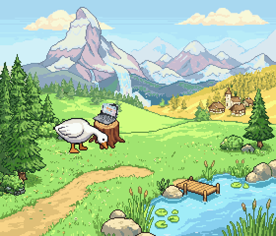

# NestBox



NestBox is a small LCD that sits next to your computer, with a pixel pet living on it. The pet works at its desk
while you type, watches while a coding agent works, calls you when the agent needs an answer, celebrates a passing
build, and goes to bed when the computer sleeps. Anything on your network can drive it with one HTTP request, and
anything on the internet through the optional [webhook relay](https://nestbox.pet/docs/webhooks/).

It runs on a Waveshare ESP32-S3-LCD-1.69 or ESP32-S3-LCD-2 board. The same C++ engine runs in a Mac simulator that
serves the same HTTP API, so everything here can be tried without the hardware.

**Docs: [nestbox.pet/docs](https://nestbox.pet/docs/)**. This repository builds all of NestBox from source: the
firmware, the simulator, the Mac companion, and the packer that turns a folder of sprite sheets into a pet.

## Try it in the simulator (macOS)

Requirements: the Xcode Command Line Tools (`xcode-select --install`) and [Homebrew](https://brew.sh).

```sh
brew install cmake sdl2
cmake -S . -B build
cmake --build build --target nestbox-sim eggs -j
build/nestbox-sim         # Nibble in a window, at the device's real size, on port 8080
```

In another terminal, make it react:

```sh
curl -d '{"from":"tests","state":"failed","say":"3 failed"}' http://localhost:8080/v1/tell
curl -d '{"from":"me","do":"dance","for":"1m","effect":"confetti"}' http://localhost:8080/v1/tell
```

To have it follow your typing, run the companion; it finds the simulator over Bonjour:

```sh
cmake --build build --target nestbox && build/nestbox
```

`http://localhost:8080/` is the device's own page (its pets and its screen settings); `GET /api` is its API
reference.

## Build and flash the board

Requirements: [PlatformIO](https://docs.platformio.org/en/latest/core/installation/) and a USB-C data cable.

```sh
scripts/package_app.sh     # the Mac app, which the board offers on its USB drive (optional)
cd firmware/esp32
pio run -t upload          # the firmware and the USB drive (the 2-inch board: add -e nestbox-2in)
pio run -t uploadfs        # the pets: Goose, Milo, Robot, Nibble and Slime, from pets/ and pets/retro/
```

The board then shows a Wi-Fi QR code; join it from a phone to set it up. If the upload can't find the board, unplug
it, hold BOOT, plug it back in, let go, and upload again. Everything else (the first board revision, choosing pets,
the USB console) is in [Firmware](https://nestbox.pet/docs/firmware/). Without building anything,
[nestbox.pet/docs/install](https://nestbox.pet/docs/install/) writes the same firmware and pets from Chrome.

## Pets

A pet is one `.egg` file: its animations, palette, scene and a short description. The firmware build installs the
eggs in `pets/` (Goose, Milo and Robot, drawn in fine pixels) and `pets/retro/` (Nibble and Slime, in chunky ones);
Nibble's is packed from `pets/retro/nibble/`. Add an egg to a running board from its own page
(`http://<pet's name>.local/`, **Add a pet**) or with `PUT /v1/pets/NAME`; the simulator loads eggs from
`~/.nestbox/pets/`.

To make your own, draw a folder of sprite sheets ([Make a pet](https://nestbox.pet/docs/pet-folder/)) and pack it
with the engine built in `build/`:

```sh
python3 tools/eggpack/eggpack.py mypet --check
python3 tools/eggpack/eggpack.py mypet -o ~/.nestbox/pets/mypet.egg
```

## Coding agents

The device serves a setup guide for agents at `GET /agents`: what to tell it at each moment of an agent's work, and
the privacy rules. Ask an agent to read `http://<device>.local/agents` and connect itself.
`integrations/claude-code/` is a ready-made set of Claude Code hooks
([Claude Code](https://nestbox.pet/docs/claude-code/)).

## On your Mac

The menu bar app (`companion/mac/app/`) runs the companion for you, and its menu adds three things: **Music** (the pet
dances to what Spotify or Apple Music plays), **Calendar** (a countdown before a meeting, quiet during it) and
**Webhooks** (a public URL for your pet, through the NestBox relay). See [Mac app](https://nestbox.pet/docs/mac-app/)
and [Webhooks](https://nestbox.pet/docs/webhooks/).

## Repository layout

| Path | Contents |
|---|---|
| `engine/` | The portable C++17 engine, built unchanged into the firmware and the simulator, in layers: `util`, `screen`, `egg`, `body`, `mind`, `door`, `host` |
| `firmware/esp32/` | The board: LCD, Wi-Fi, USB, IMU, button, console, settings (PlatformIO) |
| `simulator/` | The Mac simulator: SDL window, HTTP server, Bonjour, a fake Wi-Fi radio for setup |
| `companion/mac/` | `cli/`: the `nestbox` command; `app/`: the menu bar app; `selftest/`: the app's self-test |
| `integrations/` | Example Claude Code hooks |
| `.github/` | `ci.yml` (the tests on Linux and macOS) and `stars.yml` (a new star makes the owner's pet celebrate, through its webhook) |
| `pets/` | The eggs the firmware installs; `retro/` holds Nibble (with the folder it is packed from) and Slime |
| `tools/` | `eggpack/` (folder to egg), `studio/` and `petrecord.cpp` (a pet frame by frame), `docgen.cpp` (what the engine serves, for the packer and the docs), `demo_gif.py`, `fontgen.py`, `tzdata.py` |
| `scripts/` | `build.sh` (everything), `test_all.sh`, and the scripts that build, self-test and package the menu bar app |
| `tests/` | Unit and end-to-end tests |
| `assets/` | The animation above |

## Tests

```sh
scripts/test_all.sh            # configure, build and run every test (about 5 minutes, macOS)
scripts/test_all.sh --quick    # the unit, packer and layer tests (about a minute, Linux too)
```

How to change the code: [Contributing](https://nestbox.pet/docs/contributing/).

## Licence

The code is MIT ([LICENSE](LICENSE)); the pets in `pets/` and the animation in `assets/` are CC BY 4.0. Third-party
components and their licences are in [NOTICE.md](NOTICE.md). To report a security problem, see [Security](https://nestbox.pet/docs/security/).
